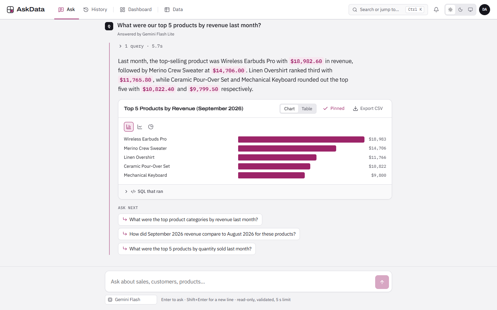
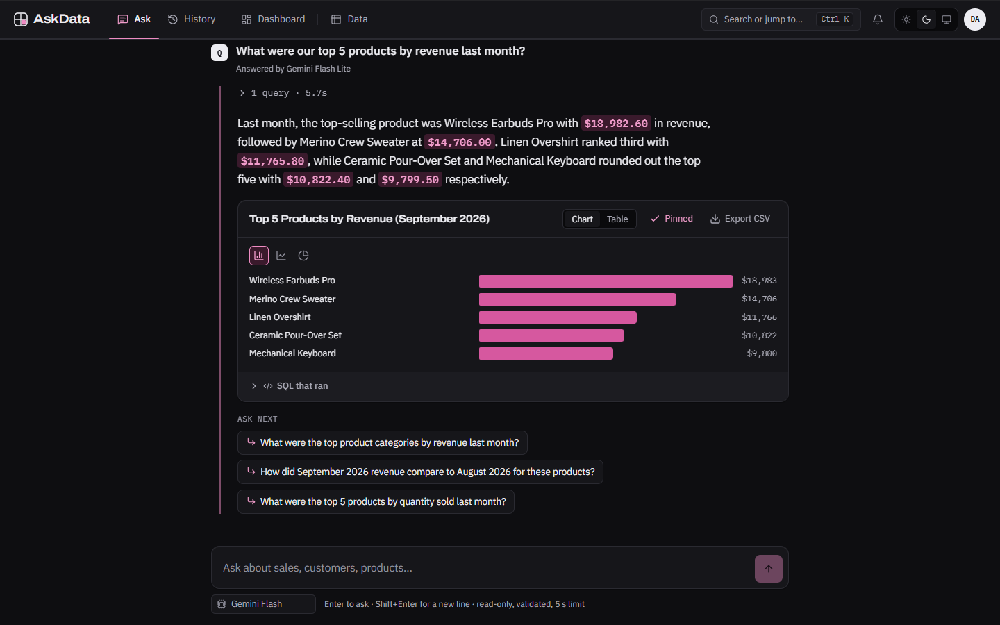
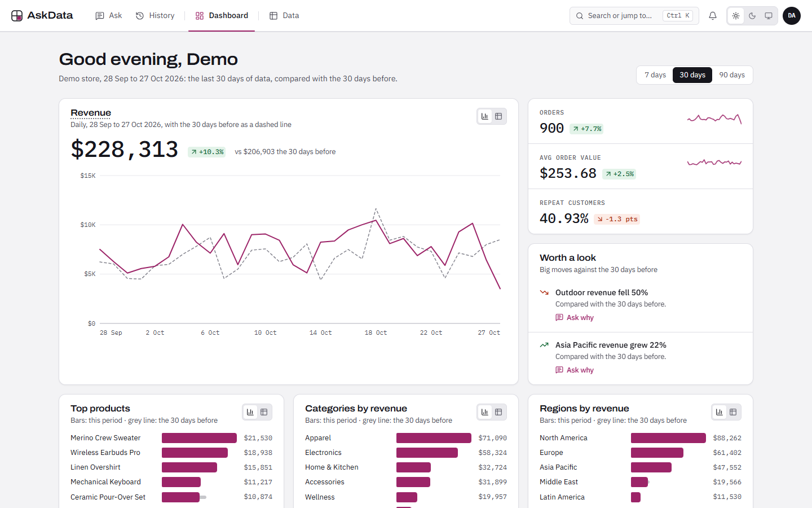
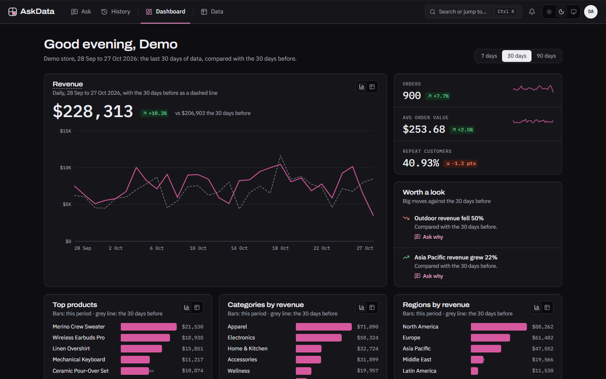
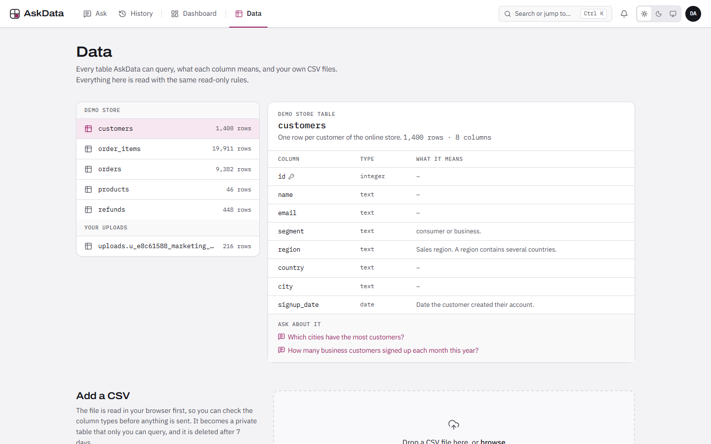
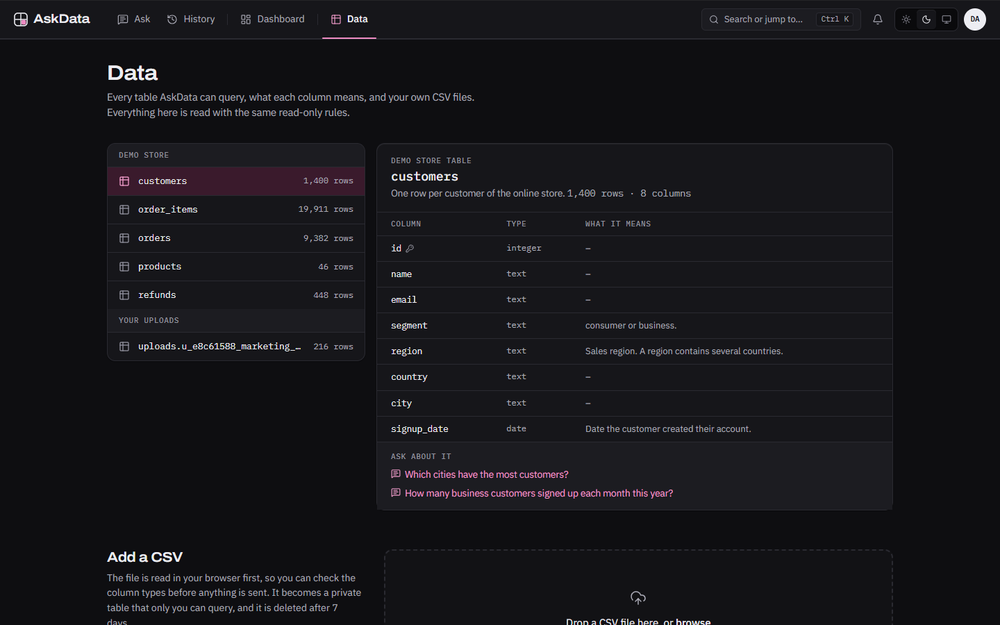

# AskData AI

**Ask your database a question in plain English, get the answer, the chart and the exact SQL.**

[](https://ask-data-ai-ten.vercel.app/)


**Live demo:** https://ask-data-ai-ten.vercel.app/ — choose **Try the demo**
(`demo@askdata.app` / `askdata-demo`), no sign-up needed.

An AI data analyst. Ask a question about a database in plain English and get back
a written insight, a chart, the result table, and the exact SQL that produced them.

Built to show how a text-to-SQL agent can be made **safe enough to point at a real
database**: the model's SQL runs through a read-only Postgres role, a parser-based
validator, a statement timeout and an enforced row limit.

- **Ask** in plain English; watch the agent work step by step (schema read, each query, each repair)
- **Verify** every answer: chart (bar / line / pie, switchable) or table of the same rows, the SQL that ran, CSV export
- **Follow up**: each answer suggests next questions, and the conversation keeps context
- **Dashboard**: revenue, orders, average order value and repeat rate for 7 / 30 / 90 days against the period before, breakdowns on hover, "worth a look" changes with a question to ask, and pinned charts that re-run their SQL on every load
- **Data**: every table the agent may query, with each column's type and business rule; upload a CSV and question it with the same safety rules
- **Resilient AI**: Google Gemini by default (free tier); a slow or busy main model hands the question to a lighter one after ~10 s; OpenAI and Anthropic Claude appear when their keys are set
- **History, Settings, Ctrl/Cmd+K palette**, light / dark / system themes

**Stack:** Next.js 16 (App Router, Cache Components, React `<ViewTransition>`) · React 19 · TypeScript (strict) ·
Tailwind CSS 4 · Vercel AI SDK 7 · Neon Postgres · Prisma 7 · `pg` · `node-sql-parser` · Auth.js v5 ·
TanStack Query · Radix primitives · own SVG charts · zod · Vitest · Playwright + axe



---

## Contents

- [Quick start](#quick-start)
- [Screens](#screens)
- [Design system](#design-system)
- [Architecture](#architecture)
- [How the agent works](#how-the-agent-works)
- [Safety layers](#safety-layers)
- [Demo data](#demo-data)
- [CSV uploads](#csv-uploads)
- [Evaluating accuracy](#evaluating-accuracy)
- [Tests](#tests)
- [Performance](#performance)
- [Deploying to Vercel](#deploying-to-vercel)
- [Environment variables](#environment-variables)
- [npm scripts](#npm-scripts)
- [API routes](#api-routes)
- [Project structure](#project-structure)
- [Troubleshooting](#troubleshooting)
- [Author](#author)

---

## Quick start

You need **Node.js 22** (`package.json` pins `"node": "22.x"`), a free
[Neon](https://neon.tech) database and a free
[Google AI Studio](https://aistudio.google.com/apikey) API key.

```bash
git clone https://github.com/murtaza008/AskData-AI.git
cd AskData-AI
npm install            # also runs `prisma generate`
cp .env.example .env
```

Fill in `.env`. Only four values are required:

| Variable | Where it comes from |
| --- | --- |
| `DATABASE_URL` | Neon dashboard → Connect → **pooled** connection string |
| `GOOGLE_GENERATIVE_AI_API_KEY` | https://aistudio.google.com/apikey |
| `AUTH_SECRET` | `npx auth secret`, or any long random string |
| `ANALYTICS_ROLE_PASSWORD` | any long random string (becomes the read-only role's password) |

> **Important:** `.env.example` ships with *placeholder* values for `DIRECT_URL`
> and `ANALYTICS_DATABASE_URL`. Either replace them with real connection strings
> or set them to `""`. When they are empty, both are derived automatically from
> `DATABASE_URL` (+ `ANALYTICS_ROLE_PASSWORD`); a leftover placeholder is used
> as-is and the migration / read-only connection will fail.

Then create everything in the database and start the app:

```bash
npm run db:init   # migrate app tables → create the read-only role → seed demo data
npm run dev
```

Open http://localhost:3000 and choose **Try the demo**. The demo login is
`demo@askdata.app` / `askdata-demo` (it is printed on the login page on purpose).

`db:init` is three steps you can also run one at a time:

| Command | What it does |
| --- | --- |
| `npm run db:migrate` | Applies the Prisma migration: the `app` schema (users, conversations, pins, uploads) |
| `npm run db:setup` | Creates the `askdata_readonly` role and the `analytics` / `uploads` schemas, then **verifies** the role cannot write or read app tables |
| `npm run db:seed` | Builds the demo e-commerce dataset and the demo account. Safe to re-run; it refreshes the data so "last month" is always recent |

---

## Screens

Captured from the real app, signed in as the demo account (`npm run screens`).

| | Light | Dark |
| --- | --- | --- |
| An answer |  |  |
| Dashboard |  |  |
| Data |  |  |

The landing page (`/`) tells the same story in a CSS 3D scroll scene: the question,
the demo store's five tables, the SQL, and the five result rows that turn into the
chart's bars. Its numbers come from a read-only snapshot of the demo data
(`npm run landing:data`), and its three demos run the app's own modules in the
browser: the SQL validator, CSV type inference and chart-spec repair.

---

## Design system

- **Tokens.** Every colour is a CSS variable with a light and a dark value
  (`src/app/globals.css`), so one utility class works in both themes. One accent
  (berry `#9c2468`, `#ee8cc3` in dark); danger is vermilion, a clearly different hue;
  success is green and never used for the accent or for danger. Printed pages stay light.
- **Contrast.** `npm run check:contrast` checks every text/background pair the UI uses
  for WCAG AA (4.5:1 for text, 3:1 for icons, chart marks and focus rings) in both themes.
- **Charts.** Small SVG components (`src/components/charts`), no chart library. One
  y-axis; single-series charts use the accent; categorical colours follow a fixed
  order that was run through a colour-blind separation validator in both themes, and
  anything past the fifth series folds into "Other". Every dashboard chart has a table view.
- **Type.** Archivo (semi-expanded) for headings, IBM Plex Sans for text, IBM Plex Mono
  for figures and SQL.
- **Depth.** 1px borders, layered surfaces and soft shadows, with an inset top
  highlight in dark mode. No gradients, blur or glow.
- **Theme.** Light, dark or system, applied before first paint (no flash). Switching
  reveals the new theme in a circle from the toggle (View Transitions API), instantly
  when that is unsupported or motion is reduced.
- **Motion.** Expo-out, 150–450 ms: page changes fade out and rise in, numbers count
  to their value (the final value is in `data-value`), lines draw in, bars grow from
  the baseline, lists rise in staggered. Press and pin feedback run outside React and
  only for pointer input. All of it is off with `prefers-reduced-motion`.
- **Hover.** One `HoverCard` component: nav items say what the page is for with live
  counts, KPIs show their breakdown (also on keyboard focus), history rows and tables
  preview what the row already holds. Hover only adds detail; everything is reachable
  by click and keyboard.

---

## Architecture

```
Browser                         Next.js server                         Postgres (Neon)
───────                         ──────────────                         ───────────────
Chat UI ── POST /api/chat ────▶ auth check ─▶ agent loop
   ▲                              │  getSchema ─────────────────────▶ analytics.*  ┐ read-only role
   │   NDJSON stream              │  runQuery ─▶ validate ─▶ execute ▶ uploads.*   ┘ (askdata_readonly)
   └── steps + final answer ◀─────┤  submitAnswer
                                  │
Dashboard, history, uploads ────▶ REST routes ─▶ Prisma ────────────▶ app.*          owner role
```

Two database connections, kept apart on purpose:

- **Owner connection (Prisma).** App data only: users, conversations, pinned charts,
  upload metadata. It lives in the `app` schema. The agent never touches this connection.
- **Read-only connection (`pg` pool).** Logs in as `askdata_readonly`, which has
  `SELECT` on the `analytics` and `uploads` schemas and nothing else. Every piece of
  SQL written by a model, and every stored query a pinned chart re-runs, goes through
  this pool.

The UI is a static shell (Next.js Cache Components) with client-side data fetching
through TanStack Query, so pages load instantly and the API is the only thing that
reads the session. `src/proxy.ts` redirects signed-out visitors, and **every API
route re-checks the session itself**; the proxy is a convenience, not the boundary.

---

## How the agent works

The agent is a multi-step tool-calling loop on the Vercel AI SDK
([`src/server/agent/run-agent.ts`](src/server/agent/run-agent.ts)), capped at 10 model
steps and 50 seconds.

```
getSchema ──▶ runQuery ──▶ (error? read it, fix the SQL, runQuery again, up to 3 failures) ──▶ submitAnswer
```

| Tool | What it does |
| --- | --- |
| `getSchema` | Returns tables, columns, types, primary/foreign keys, column comments (business rules), sample values for text columns, value ranges for numeric/date columns, row counts and today's date. Cached in memory. |
| `runQuery` | Validates and executes one `SELECT`. Returns the columns, row count and the first 40 rows to the model, or the database's error message so the model can repair the query. |
| `submitAnswer` | Ends the run. Its zod-validated input is the structured answer: `answerable`, a 2–3 sentence `insight`, which query result to present, a chart spec (`type`, `x`, `y`, `title`, `yFormat`) and follow-up questions. |

Design decisions worth knowing:

- **The model must use tools.** `toolChoice: "required"` on every step, and the only
  way to finish is `submitAnswer`. A structured "answer tool" is more reliable across
  providers than asking for JSON in prose.
- **The schema is always read first, by the server.** Inspecting the schema has only
  one right answer, so the server runs `getSchema` itself at the start of every run
  (it shows as the first step in the trace) and hands the result to the model. That
  saves a full model round-trip per question. The tool stays available for re-reading.
- **Main model, then fallback.** Each step of the main model gets about 10 seconds
  and no silent retries. On a timeout, a 429 or a 5xx before any query has run, the
  same request goes to the provider's lighter model (for Gemini: Flash Lite), and
  the trace shows "Main model busy · switched to …". Any other 4xx (bad request,
  bad key) and a cancel by the user are shown as they are, never retried.
- **Time budget.** A run has 50 seconds in total. If the model fails after a query
  succeeded, the user still gets the chart and table, without a written summary.
- **The model never retypes data.** It picks a result by id; the rows shown in the
  table and chart come from the server's copy of the query result. The table and chart
  therefore cannot contain invented numbers.
- **No result, no figures.** If the model claims an answer without one successful
  query behind it, the server discards that claim and reports that it could not answer.
- **Honest refusals.** When the data cannot answer the question, the model sets
  `answerable: false` and explains what is missing. The UI shows this as a distinct
  "couldn't answer that from this data" state.
- **Self-repair is bounded.** After 3 failed queries the tool refuses further queries
  and the next step is forced to `submitAnswer`.
- **Chart specs are checked, not trusted.** Field names are validated against the
  real result columns; an unusable spec is repaired or downgraded to a table
  ([`src/lib/agent/chart.ts`](src/lib/agent/chart.ts)).
- **Live progress.** Each tool reports step updates that `/api/chat` streams to the
  browser as newline-delimited JSON, so the trace appears as the agent works.

Switching providers is a one-line change per provider in
[`src/server/ai/models.ts`](src/server/ai/models.ts). `AI_PROVIDER` picks the default;
the model picker in the sidebar lists only providers whose API key is configured.

---

## Safety layers

Each layer works on its own. Breaking one does not expose the database.

### 1. A separate read-only database role

Model-written SQL never runs on the app's connection. It runs as `askdata_readonly`,
created by `npm run db:setup`. The exact SQL is in
[`sql/01-readonly-role.sql`](sql/01-readonly-role.sql):

```sql
CREATE ROLE askdata_readonly WITH
  LOGIN PASSWORD 'CHANGE_ME'
  NOSUPERUSER NOCREATEDB NOCREATEROLE NOREPLICATION NOINHERIT;

ALTER ROLE askdata_readonly SET default_transaction_read_only = on;
ALTER ROLE askdata_readonly SET statement_timeout = '5s';
ALTER ROLE askdata_readonly SET idle_in_transaction_session_timeout = '15s';
ALTER ROLE askdata_readonly SET search_path = analytics;

CREATE SCHEMA IF NOT EXISTS analytics;
CREATE SCHEMA IF NOT EXISTS uploads;

GRANT USAGE ON SCHEMA analytics, uploads TO askdata_readonly;
GRANT SELECT ON ALL TABLES IN SCHEMA analytics TO askdata_readonly;
GRANT SELECT ON ALL TABLES IN SCHEMA uploads TO askdata_readonly;
ALTER DEFAULT PRIVILEGES IN SCHEMA analytics GRANT SELECT ON TABLES TO askdata_readonly;
ALTER DEFAULT PRIVILEGES IN SCHEMA uploads GRANT SELECT ON TABLES TO askdata_readonly;

REVOKE ALL ON SCHEMA app FROM askdata_readonly;
REVOKE ALL ON ALL TABLES IN SCHEMA app FROM askdata_readonly;
```

The role has no privileges on the `app` schema, so the users table and password
hashes are invisible to it. `db:setup` finishes by logging in as the role and
confirming it cannot create a table or read `app."User"`.

### 2. SQL validation with a real parser

Before execution, [`src/server/sql/validate.ts`](src/server/sql/validate.ts) parses
the SQL into an AST with `node-sql-parser` (PostgreSQL grammar) and requires that:

- it parses, and is **exactly one statement**
- that statement is a `SELECT` (CTEs allowed). `INSERT`, `UPDATE`, `DELETE`, `DROP`,
  `ALTER`, `TRUNCATE`, `GRANT`, `SET`, `COPY`, `SELECT … INTO` and `FOR UPDATE` are rejected
- **every table is on the request's allow-list**: the analytics tables plus the
  asking user's own uploads. That excludes the app's tables, other users' uploads,
  `information_schema` and `pg_catalog`, including unqualified catalog names and
  catalogs "shadowed" by a CTE name
- it calls **no dangerous function**: `pg_*`, `dblink*`, `lo_*`, `set_config`,
  `current_setting`, `query_to_xml` and similar, and any schema-qualified function

### 3. Statement timeout

Queries run with `SET LOCAL statement_timeout` (default 5 s, `QUERY_TIMEOUT_MS`).
Postgres cancels anything slower. The role carries the same limit as a default, so
it applies even if application code forgot.

### 4. Automatic row limit

A validated query is wrapped as `SELECT * FROM (<query>) AS askdata_result LIMIT n+1`
(default 500, `QUERY_ROW_LIMIT`). The cap holds whatever `LIMIT` the model wrote, and
the extra row tells the UI the result was truncated.

### 5. Read-only transaction, pinned search path

Each query runs inside `BEGIN TRANSACTION READ ONLY` with `search_path` pinned to
`analytics`, and is always rolled back.

### 6. Schema exposure

`getSchema` describes only the allow-listed tables. The model is never told the app
tables exist.

### 7. Secrets stay on the server

Database URLs and API keys are read only in modules that import `server-only`, which
makes importing them from client code a build error. The browser receives model ids
and labels, never keys.

### Also in place

- Pinned charts get no special trust: their stored SQL passes through layers 1–5 again on every load.
- CSV cell values are sent as bind parameters; identifiers are rebuilt from scratch (`a–z`, `0–9`, `_`) and quoted.
- Conversations, pins and uploads are scoped by user id in every query.
- CSV export neutralises spreadsheet formula injection.
- The sign-in `callbackUrl` only accepts same-origin `/app` paths (no open redirect).
- The shared demo account has a daily question quota (`DEMO_DAILY_QUESTIONS`).

### Known limits

- Isolation between different users' uploads is enforced by the validator's
  allow-list (application layer). The database role can read the whole `uploads`
  schema. Per-user roles or row-level security would move that into the database.
- Function blocking is a deny-list. The read-only role and timeout are what bound
  the damage if a function is missed.

---

## Demo data

`npm run db:seed` builds an e-commerce dataset in the `analytics` schema:
`customers`, `products`, `orders`, `order_items`, `refunds`. Roughly 1,400 customers,
46 products, 9,400 orders and 20,000 line items across the last 12 months.

The generator ([`scripts/lib/dataset.ts`](scripts/lib/dataset.ts)) is deterministic
and bakes in patterns so charts have something to show: steady growth across the year, a
November–December peak with a Black Friday week, a few best-sellers and a long tail,
a loyal minority of repeat customers, category seasonality, refund rates that differ
by category, regions of different size, and mobile's share of orders rising.

Column comments carry business rules ("revenue excludes cancelled and refunded
orders"). The agent reads them through `getSchema`, which is how it learns them.

---

## CSV uploads

On **Upload data**, a CSV is parsed in the browser, column types are inferred, and
you can correct them before anything is sent. The server re-parses the file with the
same inference code, creates a table `uploads.u_<user>_<file>` and loads the rows.

- Limits: 4 MB (`UPLOAD_MAX_MB`), 50,000 rows, 40 columns, 5 tables per user
- Types: text, number, date, boolean. Currency symbols, thousands separators and percent signs are understood
- Uploads expire after 7 days (`UPLOAD_TTL_DAYS`). A daily Vercel Cron job (`vercel.json`) drops expired tables, and the list endpoint also cleans up on access
- The agent sees a user's uploads next to the demo tables and queries them under the same safety rules

**Sample file.** [`scripts/demo-data/marketing_spend.csv`](scripts/demo-data/marketing_spend.csv)
holds ~200 rows of weekly ad spend by channel and campaign. `npm run db:seed` loads it
into the **demo account** as a permanent sample upload (it never expires, can't be
deleted from the UI, doesn't count towards the 5-table limit, and its dates are shifted
so the latest week is last week). That is why *"How much did we spend on marketing last
quarter?"* works in the demo. On your own account the question is declined until you
upload the file yourself, which shows the agent picking up a new table.

---

## Evaluating accuracy

```bash
npm run eval
```

[`scripts/eval/cases.ts`](scripts/eval/cases.ts) holds 17 questions: 15 answerable
ones (totals, rankings, breakdowns, trends) and 2 that the data cannot answer. Each
answerable case carries a hand-written **gold SQL** query. The runner sends the
question through the real agent, runs the gold query for the true answer, and checks
the agent's result rows against it. The two unanswerable cases pass only if the agent
declines. Because the truth is computed from the live data, the suite keeps working
after a re-seed.

```
✔ revenue-last-month            6.1s  found 198879.2
✔ top-products-last-month       7.4s  matched wireless earbuds pro > merino crew sweater > …
✖ aov-by-channel                5.9s  web: expected 229.36, got [231.02]
    SQL: SELECT channel, avg(total_amount) …

Accuracy: 16/17 (94%) · avg 6.3s per question
```

(Illustrative output. Run it against your own key to get real numbers.)

Options: `--only <text>` filters cases by id, `--model <id>` picks a model
(for example `openai:gpt-5.4-mini`), `--delay <ms>` spaces out calls for free-tier
rate limits, `--min <0..1>` sets the pass threshold. The process exits non-zero below
the threshold, so it can gate CI.

---

## Tests

```bash
npm test          # unit tests (no database or API key needed)
npm run typecheck
npm run lint
```

- `tests/sql-validate.test.ts`: about 50 accept/reject cases for the SQL validator
- `tests/agent.test.ts`: the agent loop against the AI SDK's mock model: normal flow, self-repair, retry cap, honest refusal, chart repair, provider errors, and the main-model fallback (busy 429, server error 503, slow step, bad request 400 not retried, user cancel)
- `tests/api.test.ts`, `tests/overview.test.ts`: route handlers with the session and database faked: 401 signed out, 403 for the shared demo's destructive actions, 404 for another user's records, 400 for bad input, per-user scoping, the dashboard's period anchoring, and that no sample values or secrets leave the server
- `tests/lib.test.ts`: chart-spec resolution, CSV type inference, CSV export escaping, callback URL validation

### End-to-end (Playwright + axe)

```bash
npm run build
npm run test:e2e        # starts `next start` on port 3200 itself
npm run verify          # contrast, lint, types, unit, build, e2e in one go
```

The e2e suite signs in as the shared demo account against the database in `.env`
and is **strictly read-only**: `POST /api/chat` is always answered by a mock (success,
busy, bad request, a streamed provider error, a request the user stops), creating a pin
is mocked, and nothing else writes. It covers:

- an axe WCAG 2.1 AA scan of every page and of every menu, dialog, drawer and hover
  card, in light and dark, after animations finish
- no page scrolls sideways at 390 px; the landing page logs no console errors
  (hydration mismatches show up there); the story's still picture works without JavaScript
- the landing demos running the real validator, type inference and chart repair
- navigation, the command palette, the dashboard's periods and table views, the Ask
  flow end to end, and what the demo account is not allowed to do

Two workers and one retry, because every app page waits on a remote database.
`tests/e2e/.auth/` (a real session cookie) and `tests/e2e/.results/` are git-ignored.

---

## Performance

First-load JavaScript per route (gzip), measured from the HTML of a production
server with `npm run bundle:report` (signed-in routes as the demo account). Lazy
chunks are not counted: the landing's 3D scene, the SQL parser used by the landing
demo, Lenis and the command palette load on demand.

| Route | Before the redesign | After |
| --- | ---: | ---: |
| `/` | 339.5 kB | 235.5 kB |
| `/login` | 342.6 kB | 192.7 kB |
| `/signup` | 372.4 kB | 222.2 kB |
| 404 | 217.2 kB | 176.5 kB |
| `/app` (Ask) | 377.7 kB | 284.0 kB |
| `/app/c/[id]` | 377.7 kB | 284.0 kB |
| `/app/dashboard` | 374.3 kB | 281.4 kB |
| `/app/upload` (Data) | 270.4 kB | 282.2 kB |
| `/app/history` (new) | – | 271.7 kB |
| `/app/settings` (new) | – | 270.5 kB |

Most of the drop comes from replacing Recharts with small SVG charts and loading
Motion only on the landing page. `/app/upload` grew by 11.8 kB: before, it was the one
app page without Recharts, and now every app page carries the shared shell (Radix
menus, hover cards and dialog for the palette and drawer) plus the new table
explorer. Raw numbers: `docs/perf/bundle-before.json`, `docs/perf/bundle-after.json`.

Also: each page's code is prefetched when the browser is idle after sign-in and on
nav hover, and its data on nav hover (never anything that calls the AI).

---

## Deploying to Vercel

1. Push the repository to GitHub and import it at https://vercel.com/new.
2. Under **Environment Variables**, add `DATABASE_URL`, `DIRECT_URL` (the same
   Neon string without `-pooler` in the host), `ANALYTICS_ROLE_PASSWORD`,
   `AUTH_SECRET`, `GOOGLE_GENERATIVE_AI_API_KEY`, `AI_PROVIDER=google` and `CRON_SECRET`.
   Use the same `ANALYTICS_ROLE_PASSWORD` you ran `db:setup` with.
3. Deploy. Vercel runs the `vercel-build` script, which applies migrations before building.
4. If you have not already, run `npm run db:setup` and `npm run db:seed` once from
   your machine with the production `DATABASE_URL` in `.env`.
5. Open `https://<your-app>.vercel.app/api/health`. It reports `ok` / `failed` /
   `missing` for the app database, the read-only role, the demo data, `AUTH_SECRET`
   and the AI provider, without revealing any values, so you can see at a glance
   which piece of configuration is wrong. It returns HTTP 503 until every check passes.

Notes for the free (Hobby) tier:

- `/api/chat` sets `maxDuration = 60`, within the Hobby limit.
- Vercel rejects request bodies above 4.5 MB, which is why uploads default to 4 MB.
- Hobby cron jobs run once a day; `vercel.json` schedules the upload clean-up for 04:00 UTC.
- Gemini's free tier allows only a few requests per minute, each question is two or
  more requests, and at busy times the free models answer slowly or return "high
  demand" errors. The app handles this with a fallback model, a 50-second budget and a
  clear message, but a paid key (or OpenAI / Claude) gives a much smoother demo.
- `npm run eval` sends 17 questions (roughly 40 to 60 model requests). On a free key,
  run it sparingly and raise `--delay`.

---

## Environment variables

Documented in full in [`.env.example`](.env.example).

| Variable | Required | Purpose |
| --- | --- | --- |
| `DATABASE_URL` | yes | Owner connection (pooled). App data, migrations, seeding |
| `DIRECT_URL` | no | Non-pooled connection for migrations. Derived from `DATABASE_URL` if empty |
| `ANALYTICS_ROLE_PASSWORD` | yes | Password of the read-only role |
| `ANALYTICS_DATABASE_URL` | no | Read-only connection string. Derived from the two above if empty |
| `AUTH_SECRET` | yes | Signs session cookies |
| `AI_PROVIDER` | no | Default provider: `google` (default), `openai` or `anthropic` |
| `GOOGLE_GENERATIVE_AI_API_KEY` | one of three | Gemini |
| `OPENAI_API_KEY` | optional | Enables OpenAI models in the picker |
| `ANTHROPIC_API_KEY` | optional | Enables Claude models in the picker |
| `QUERY_ROW_LIMIT` | no | Max rows per query (500) |
| `QUERY_TIMEOUT_MS` | no | Statement timeout (5000) |
| `UPLOAD_MAX_MB` / `UPLOAD_TTL_DAYS` | no | Upload size limit (4) and lifetime (7) |
| `DEMO_DAILY_QUESTIONS` | no | Daily quota for the demo account (150) |
| `CRON_SECRET` | for cron | Protects the clean-up endpoint |
| `AUTH_URL` | no | Only needed behind a proxy or custom domain |

---

## npm scripts

| Script | What it does |
| --- | --- |
| `npm run dev` | Start the dev server on http://localhost:3000 |
| `npm run build` / `npm start` | Production build (`prisma generate && next build`) and server |
| `npm run vercel-build` | Build used on Vercel: also applies migrations (`prisma migrate deploy`) |
| `npm run db:init` | `db:migrate` → `db:setup` → `db:seed` in one go |
| `npm run db:migrate` | Apply Prisma migrations (the `app` schema) |
| `npm run db:setup` | Create and verify the read-only role and the `analytics` / `uploads` schemas |
| `npm run db:seed` | (Re)build the demo dataset and the demo account |
| `npm run eval` | Accuracy eval against the live agent (uses your AI quota) |
| `npm test` | Unit tests (Vitest), no database or API key needed |
| `npm run typecheck` | `tsc --noEmit` |
| `npm run lint` | ESLint |
| `npm run test:e2e` | Playwright + axe end-to-end suite (read-only, AI mocked); run `npm run build` first |
| `npm run check:contrast` | WCAG AA check of every colour pair in both themes |
| `npm run verify` | Contrast, lint, types, unit tests, build and e2e in one go |
| `npm run bundle:report` | First-load JS per route from a running production server |
| `npm run screens` | Rebuild, re-capture the README / landing screenshots (light and dark), rebuild |
| `npm run landing:data` | Refresh the landing page's read-only snapshot of the demo data |

---

## API routes

Every route except `/api/health`, `/api/register` and the cron endpoint requires a
signed-in session, and every query is scoped to the caller's user id.

| Method | Route | Purpose |
| --- | --- | --- |
| `POST` | `/api/chat` | Run the agent for one question; streams NDJSON (`start` → `step`… → `answer`) |
| `GET` | `/api/conversations` | List the user's conversations, with turn count and a short preview of the latest answer |
| `GET` `PATCH` `DELETE` | `/api/conversations/[id]` | Read, rename or delete a conversation |
| `GET` `POST` | `/api/pins` | List pinned charts / pin an answer to the dashboard |
| `DELETE` | `/api/pins/[id]` | Unpin a chart |
| `GET` | `/api/pins/[id]/data` | Re-run a pinned chart's SQL through the safety pipeline |
| `GET` | `/api/overview?days=7\|30\|90` | Dashboard: KPIs with breakdowns and daily series, daily revenue, categories, regions, top products and "worth a look" items, for the last N days of data against the N days before (400 for any other N) |
| `GET` `POST` | `/api/uploads` | List uploads / upload a CSV (multipart) |
| `DELETE` | `/api/uploads/[id]` | Drop an uploaded table |

The shared demo account cannot rename or delete conversations, unpin charts or delete
uploads (403), so the examples stay in place for the next visitor.
| `GET` | `/api/datasource` | Tables the agent can see for this user, with column names, types and business-rule notes (no sample values) |
| `GET` | `/api/me` | The signed-in account and its question usage (the demo account's daily limit) |
| `GET` | `/api/models` | Models whose provider key is configured, plus the default |
| `POST` | `/api/register` | Create an account |
| `GET` | `/api/cron/cleanup-uploads` | Drop expired uploads (`Authorization: Bearer $CRON_SECRET`) |
| `GET` | `/api/health` | Deployment self-check |

---

## Project structure

```
prisma/                  App schema + migration (schema `app`)
sql/                     Read-only role SQL and analytics DDL (readable, runnable by hand)
scripts/
  db-setup.ts            Create + verify the read-only role
  seed.ts                Load demo data and the demo account
  lib/dataset.ts         Deterministic dataset generator
  eval/                  Eval cases and runner
  gen-landing-data.ts    Read-only snapshot of demo figures for the landing page
  check-contrast.mjs     WCAG contrast check of the colour tokens
  bundle-report.mjs      First-load JS per route
  screens.mjs            Re-capture README / landing screenshots
tests/                   Unit and route tests (validator, agent loop, API, helpers)
  e2e/                   Playwright + axe suite (read-only, AI mocked)
docs/perf/               Bundle measurements before and after the redesign
src/
  proxy.ts               Redirects signed-out visitors (Next.js 16 "proxy")
  app/
    (marketing)/         Landing page
    (auth)/              Login, sign-up
    app/                 Workspace: ask, conversation, history, dashboard, data (upload), settings
    api/                 Route handlers: chat (streaming), conversations, pins, uploads, models, …
  server/                Server-only code
    agent/               Agent loop and system prompt
    ai/                  Provider registry (Gemini / OpenAI / Claude)
    sql/                 Guarded executor, schema introspection
    db/                  Prisma client and pg pools
    auth/                Auth.js configuration
    services/            Conversations, pins, uploads, dashboard figures, data source
  features/              UI by feature: chat, dashboard, upload, auth, landing, settings, workspace
    <feature>/components/
    <feature>/hooks/
  components/            Shared UI: SVG charts, data table, SQL block, buttons, menus, hover card
  lib/                   Isomorphic code: types, SQL validator, chart logic, dashboard maths,
                         formatting, CSV, query options shared by hooks and prefetching
```

The footer's author name and repository link come from [`src/lib/site.ts`](src/lib/site.ts);
change them there if you fork the project.

---

## Troubleshooting

| Symptom | Likely cause and fix |
| --- | --- |
| `db:migrate` or `db:setup` cannot connect | `DIRECT_URL` still holds the `.env.example` placeholder. Set it to `""` or to the non-pooled Neon string |
| Every question fails with a permission or login error | `ANALYTICS_ROLE_PASSWORD` differs from the one `db:setup` used, or `ANALYTICS_DATABASE_URL` is a leftover placeholder. Re-run `npm run db:setup` (it re-syncs the password) |
| "No AI provider is configured" | No provider key is set. Add `GOOGLE_GENERATIVE_AI_API_KEY` (or an OpenAI / Anthropic key) |
| "rate limit was reached" / "high demand" | Gemini free-tier limits. Wait a minute, or switch model in the sidebar picker |
| Dashboard shows no data | The demo dataset is missing. Run `npm run db:seed` |
| `/api/health` returns 503 | Read which check is not `ok`; the function logs on Vercel show the underlying error |

---

## Author

Built by **Murtaza Mazhar** — [GitHub @murtaza008](https://github.com/murtaza008) ·
[Repository](https://github.com/murtaza008/AskData-AI) · [Live demo](https://ask-data-ai-ten.vercel.app/)
